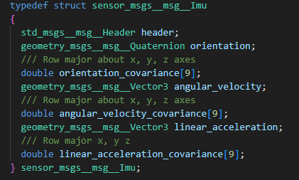

# 自定义消息

## 官方资料

1. [官方github构建工具仓库](https://github.com/micro-ROS/micro_ros_stm32cubemx_utils)

2. [自定义消息官方教程](https://micro.vulcanexus.org/docs/tutorials/advanced/create_new_type/)

## 实用性

**ROS 2** 的标准消息是原生自带的， 不需要自行添加，缺点是字段较为冗余，拿上个例程中的 `sensor_msgs/msg/detail/imu__struct.h` 举例：



从结构体里可以看到它完整的字段组成：

- **`header`**：时间戳与坐标系 ID（`frame_id`）。
- **`orientation`** 与 **`orientation_covariance[9]`**：四元数姿态（x, y, z, w）及其 **3 × 3** 协方差矩阵。
- **`angular_velocity`** 与 **`angular_velocity_covariance[9]`**：三轴角速度及其协方差矩阵。
- **`linear_acceleration`** 与 **`linear_acceleration_covariance[9]`**：三轴线加速度及其协方差矩阵。

在实际的工程中，我们许多时候不会用到这么多量，如果使用这个消息类型，必定会浪费内存，所以自定义消息就成了必不可少的实用选项。

## 构建步骤

### 在 WSL 中创建自定义消息功能包

1. 创建功能包与 `msg` 文件夹

    打开 WSL 终端，进入你的工作空间并创建名为 `my_custom_msgs` 的功能包：

    ```
    source /opt/ros/humble/setup.bash
    cd ~/uros_ws/src
    ros2 pkg create --build-type ament_cmake my_custom_msgs
    cd my_custom_msgs
    mkdir msg
    ```

2. 编写 `.msg` 消息定义文件

    消息文件名必须采用 **大驼峰命名** 即 **每个单词的首字母都大写，单词之间直接拼接，不使用下划线或空格**。（参考 [ROS 2 接口概念文档](https://docs.ros.org/en/humble/Concepts/Basic/About-Interfaces.html)）。例如创建 `msg/SensorData.msg`：

    ```
    cat << 'EOF' > msg/SensorData.msg
    int32 sensor_id
    float32 temperature
    float32 humidity
    EOF
    ```

3. 修改 `CMakeLists.txt`

    将原文件替换为以下内容：

    ```
    cmake_minimum_required(VERSION 3.8)
    project(my_custom_msgs)
   
    if(CMAKE_COMPILER_IS_GNUCXX OR CMAKE_CXX_COMPILER_ID MATCHES "Clang")
      add_compile_options(-Wall -Wextra -Wpedantic)
    endif()
   
    find_package(ament_cmake REQUIRED)
    find_package(rosidl_default_generators REQUIRED)
   
    rosidl_generate_interfaces(${PROJECT_NAME}
      "msg/SensorData.msg"
    )
   
    ament_package()
    ```

4. 修改 `package.xml`

    在 `<buildtool_depend>ament_cmake</buildtool_depend>` 下方添加接口生成依赖：

    ```
    <build_depend>rosidl_default_generators</build_depend>
    <exec_depend>rosidl_default_runtime</exec_depend>
    <member_of_group>rosidl_interface_packages</member_of_group>
    ```

### 放入 `extra_packages` 并重新编译 STM32 静态库

[micro_ros_stm32cubemx_utils 构建脚本](https://github.com/micro-ROS/micro_ros_stm32cubemx_utils) 会自动扫描 `microros_static_library/library_generation/extra_packages/` 目录下的所有功能包文件夹（以及 `extra_packages.repos` 文件），并将它们与标准消息一起交叉编译进 `libmicroros.a`。

1. 清理旧的编译产物

    如果此前已经生成过静态库，**务必先删除旧的 `libmicroros` 输出文件夹**，否则 Docker 脚本可能会跳过部分构建或保留旧产物。

2. 复制自定义消息包源码到 `extra_packages`

    将刚才编写好的纯源码功能包 `my_custom_msgs` 复制到 `extra_packages` 目录下

    此时目录结构如下：

    ```
    microros_static_library/
    └── library_generation/
        ├── colcon.meta
        ├── extra_packages/
        │   ├── extra_packages.repos
        │   └── my_custom_msgs/
        │       ├── CMakeLists.txt
        │       ├── msg/
        │       │   └── SensorData.msg
        │       └── package.xml
        ├── library_generation.sh
        └── toolchain.cmake
    ```

3. 运行 Docker 重新生成静态库（方便起见，这里直接在 **window** 上编译，不进 **wsl** 了）

    ```
    docker run -it --rm `
      -v "${PWD}:/project" `
      -e MICROROS_LIBRARY_FOLDER=microros_static_library `
      -e http_proxy="http://host.docker.internal:<端口>" `
      -e https_proxy="http://host.docker.internal:<端口>" `
      microros/micro_ros_static_library_builder:humble
    ```

4. 验证自定义消息是否编译成功

    编译完成后，检查以下两个位置确认自定义消息已包含在内：

    - 查看 `microros_static_library/libmicroros/available_ros2_types` 文件，确认其中出现了 `my_custom_msgs/msg/SensorData`。
    - 查看 `microros_static_library/libmicroros/microros_include/my_custom_msgs/msg/` 目录，确认生成了 `sensor_data.h` 等头文件。

## 例程

与前文配置指南的例程大体框架一样，只需要修改消息类型就可完成测试。这里笔者就不多赘述，留给读者自行操作。