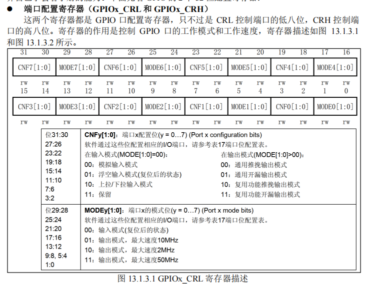

# GPIO

## 简介

`GPIO` 即 `General-Purpose Input/Output` ，通用输入输出。

---

## 工作模式

**1、输入浮空**
特点：内部上拉、下拉都关闭，引脚电平由外部电路决定。引脚悬空时，读到的 `0` 或 `1` 不确定。
场景：读取另一个芯片的推挽输出，或读取板上已有上拉、下拉电阻的信号。

**2、输入上拉**
特点：引脚通过内部**弱**上拉电阻接到电源。外部没有驱动时读 `1`，外部拉低时读 `0`。
场景：按键另一端接 GND，松开读 `1`，按下读 `0`。

**3、输入下拉**
特点：引脚通过内部**弱**下拉电阻接到地。外部没有驱动时读 `0`，外部拉高时读 `1`。
场景：按键另一端接 3.3 V，松开读 `0`，按下读 `1`。

**4、模拟功能**
特点：关闭数字输入缓冲，供 ADC、DAC 等模拟外设进行模拟输入输出。
场景：用 ADC 采集电位器或模拟传感器的输出。所选引脚需要支持对应的 ADC 通道。

**5、开漏输出**
特点：由程序控制 GPIO。写 `0` 时主动拉低，写 `1` 时释放引脚。释放后，只有在总线有上拉且没有其他器件拉低时，引脚才会变高。
场景：用 GPIO **软件模拟 I²C**，程序控制 SDA、SCL 的拉低与释放。

**6、推挽输出**
特点：由程序控制 GPIO。写 `0` 时主动拉低，写 `1` 时主动拉高。
场景：控制带限流电阻的 LED、芯片使能脚，或由软件控制的 SPI 片选脚 CS。

**7、开漏式复用功能（复用开漏输出）**
特点：由片内外设控制引脚何时拉低、何时释放，电气行为与第 5 种相同。
场景：使用**硬件 I²C** 时，SDA 和 SCL 配成复用开漏，并接总线上拉电阻。

**8、推挽式复用功能（复用推挽输出）**
特点：由片内外设控制引脚，外设可以主动输出高、低电平。
场景：USART 的 TX 发送串口数据、定时器输出 PWM、SPI 主机输出 SCK 时钟。

对于推挽输出和开漏输出，对比如下：

| 对比项             | 推挽输出                         |           开漏输出            |
| :----------------- | :------------------------------- | :---------------------------: |
| **内部电路**       | 有接向电源和接向地的两条驱动路径 |     只有接向地的驱动路径      |
| **写入 `0`**       | 主动连接到地，拉低引脚           |    主动连接到地，拉低引脚     |
| **写入 `1`**       | 主动连接到电源，拉高引脚         |    断开对地路径，释放引脚     |
| **高电平怎样产生** | 由输出电路主动提供               |      通常由上拉电阻拉高       |
| **典型场景**       | LED、SPI 时钟、串口 TX、PWM      | I²C、多器件共用的低有效信号线 |

---

## 寄存器

| 寄存器   | 名称               | 作用                                           |
| -------- | ------------------ | ---------------------------------------------- |
| **CRL**  | 低位配置寄存器     | 配置编号 **0～7** 的引脚模式和输出速度         |
| **CRH**  | 高位配置寄存器     | 配置编号 **8～15** 的引脚模式和输出速度        |
| **IDR**  | 输入数据寄存器     | 读取引脚采样到的数字电平，模拟模式下对应位读0         |
| **ODR**  | 输出数据寄存器     | 保存通用输出的控制值，也参与选择上拉、下拉输入 |
| **BSRR** | 位设置／复位寄存器 | 按位将 ODR 置 `1` 或清 `0`                     |
| **BRR**  | 位复位寄存器       | 按位将 ODR 清 `0`                              |
| **LCKR** | 配置锁定寄存器     | 按规定序列锁定指定引脚的配置，直到复位         |

这里以 **stm32f103** 的 **低位** 配置寄存器为例：

显然，CRL是一个32位寄存器，每个引脚占4位，刚好配置8个引脚。配置时，先确定 MODE，再解释 CNF。

`MODE[1:0]` 有两位，只有四种组合。

| MODE | 含义                  |
| ---- | --------------------- |
| `00` | 输入／模拟模式        |
| `01` | 输出，最大速度 10 MHz |
| `10` | 输出，最大速度 2 MHz  |
| `11` | 输出，最大速度 50 MHz |

输出速度是驱动能力相关的配置，影响引脚的输出边沿，实际的上升、下降时间还与负载有关。例如选了 50 MHz，实际应用中**什么时候进行翻转**的动作仍由程序或外设决定。

**CNF 的含义取决于 MODE。**

| CNF  | MODE 为 `00` 时 | MODE 为非零时 |
| ---- | --------------- | ------------- |
| `00` | 模拟模式        | 通用推挽输出  |
| `01` | 浮空输入        | 通用开漏输出  |
| `10` | 上拉／下拉输入  | 复用推挽输出  |
| `11` | 保留            | 复用开漏输出  |

例如，看到 `CNF=10`，还不能独立判断模式，先看对应的 MODE，判断是上拉／下拉输入，再去看 ODR 确定真正的模式。