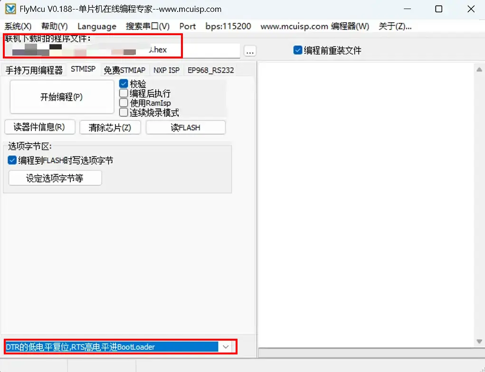
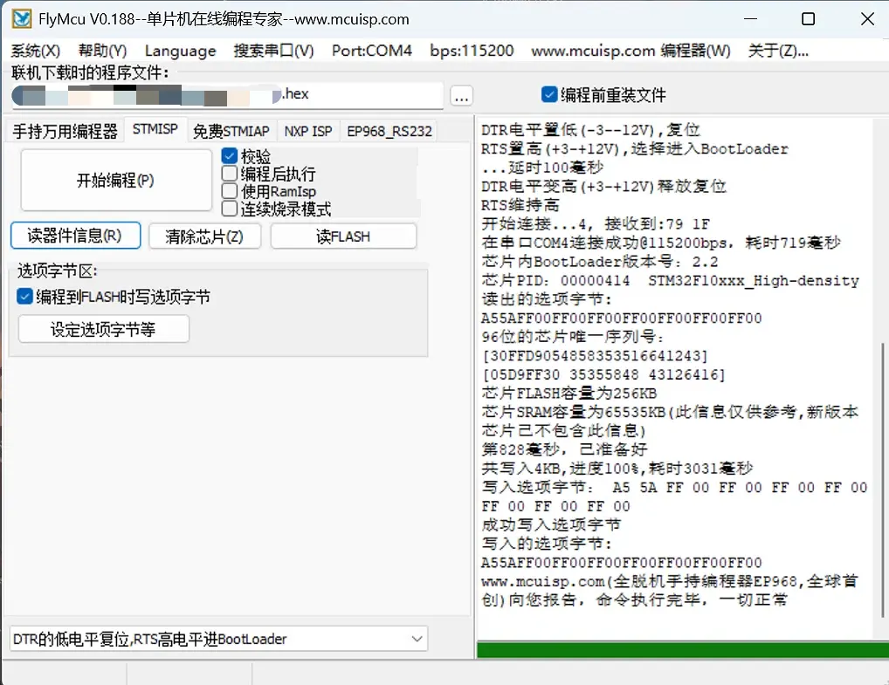
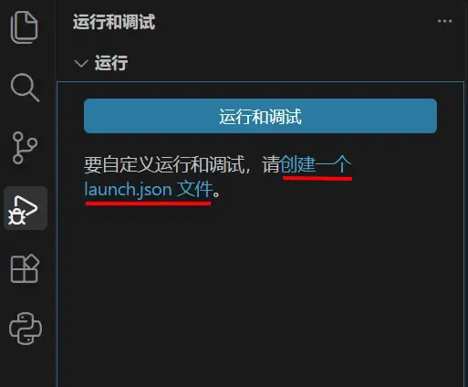
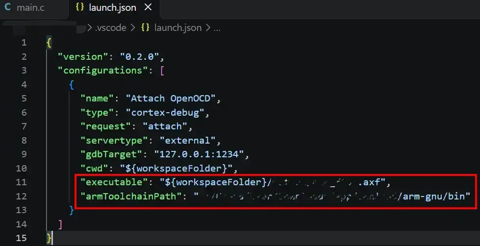
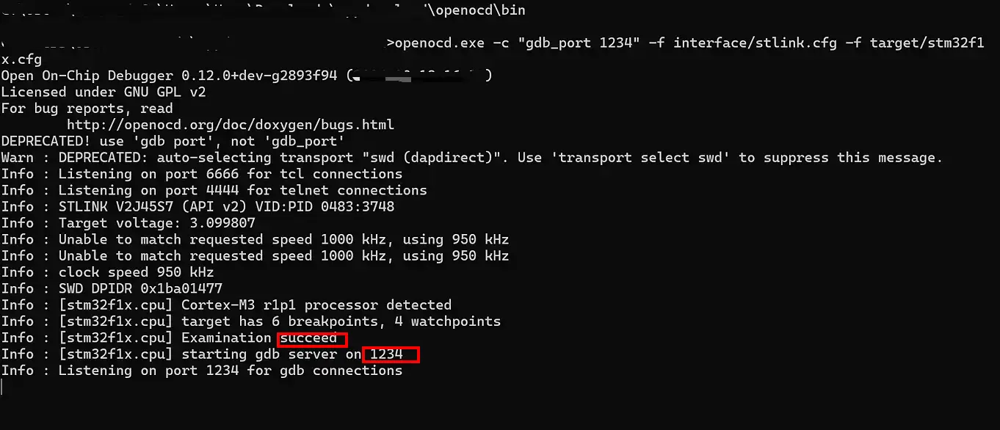

# 鸿蒙 Windows 虚拟机上的 STM32 开发与调试

## 适用环境与遇到的问题

在鸿蒙系统中运行 Windows 11 虚拟机，安装 Keil 进行 STM32 开发时，遇到了驱动兼容性问题。CH340 驱动可以通过手动添加 INF 文件安装，但同样的方法未能解决 ST-Link 的连接问题，因此需要采用其他方式进行调试。

本文记录 Keil 编译、FlyMcu 串口烧录，以及 OpenOCD 配合 VS Code 调试的操作过程。示例使用 STM32F1 系列芯片和 ST-Link V2，路径、串口号及芯片配置需根据实际环境调整。

## 原因推测

目前推测，问题可能与虚拟机的 USB 透传及 ST-Link 驱动兼容性有关。在本文记录的环境中，Keil 无法直接使用 ST-Link，而下文的 OpenOCD 配置可以连接设备。具体驱动绑定情况与失败原因仍需结合设备信息和调试日志进一步验证。

## 方案概览

将编译、烧录和调试交给不同工具完成，各工具的分工如下：

| 工具 | 负责的工作 | 使用的文件或接口 |
| --- | --- | --- |
| Keil MDK | 编写代码并编译工程 | 生成 `.hex` 固件与 `.axf` 调试文件 |
| FlyMcu | 通过串口烧录固件 | 将 `.hex` 写入 STM32 Flash |
| OpenOCD | 连接 ST-Link，提供 GDB 调试服务 | ST-Link V2、`127.0.0.1:1234` |
| VS Code + Cortex-Debug | 单步执行、设置断点与查看变量 | 读取 `.axf`，连接 OpenOCD |

## 配置与操作

以下操作均在 Windows 虚拟机内进行。

### 1. 安装 CH340 驱动

首先确保单片机的串口与电脑端能正常通信，已安装驱动的读者可跳过此步骤。

从 [CH340 驱动下载页](https://www.wch.cn/downloads/CH341SER_ZIP.html)下载 `CH341SER.ZIP`，解压后将包含 `CH341SER.INF` 等文件的文件夹放到指定目录。

以管理员身份打开命令提示符（`cmd`），执行以下命令：

```bat
pnputil /add-driver "D:\CH340\CH341SER.INF" /install
```

请将 `D:\CH340\CH341SER.INF` 替换为实际路径。

打开设备管理器，查看“端口”分类。若出现 `USB-SERIAL CH340 (COMx)` 且没有黄色感叹号，说明驱动已正常安装。记录实际的串口号，供后续烧录时使用。

### 2. 使用 FlyMcu 烧录程序

从 [FlyMcu 下载页](http://www.mcuisp.com/)获取软件。

在 Keil 中编译工程后，找到生成的 `.hex` 文件。按照下图配置 FlyMcu，重点检查红框标注的位置，并根据实际环境选择串口号和固件路径。



完成接线后，点击“开始烧录”，将程序烧录进单片机。



烧录完成后，按下开发板的 Reset 按钮，观察程序运行现象。若需要设置断点、单步执行或查看变量，继续完成以下配置。

### 3. 安装 OpenOCD 与 Arm GNU Toolchain

下载所需工具，并解压到指定目录：

- [OpenOCD 下载页](https://github.com/openocd-org/openocd/releases)
- [Arm GNU Toolchain 项目页](https://gitlab.arm.com/tooling/gnu-toolchains-for-arm)

记录 OpenOCD 和 Arm GNU Toolchain 的安装路径，后续配置需要使用。

### 4. 配置 VS Code 与 Cortex-Debug

打开 VS Code，安装 Cortex-Debug 扩展。



用 VS Code 打开工程文件夹，在“运行和调试”面板中创建 `launch.json`，将配置保存到工程的 `.vscode/launch.json` 文件中。

以下为与截图对应的可复制配置，其中的文件路径为示例，请根据实际环境修改：

```json
{
  "version": "0.2.0",
  "configurations": [
    {
      "name": "Attach OpenOCD",
      "type": "cortex-debug",
      "request": "attach",
      "servertype": "external",
      "gdbTarget": "127.0.0.1:1234",
      "cwd": "${workspaceFolder}",
      "executable": "${workspaceFolder}/Objects/project.axf",
      "armToolchainPath": "D:/tools/arm-gnu/bin"
    }
  ]
}
```



需要检查的配置项：

- `executable`：Keil 编译生成的 `.axf` 文件路径。请将示例中的 `Objects/project.axf` 替换为实际文件路径。
- `armToolchainPath`：Arm GNU Toolchain 中存放 `arm-none-eabi-gdb.exe` 的 `bin` 目录。
- `gdbTarget`：OpenOCD 的 GDB 服务地址，端口需与下一步的启动命令一致。

JSON 中的 Windows 路径建议使用正斜杠 `/`。如果使用反斜杠，需要写成 `\\`，例如 `D:\\tools\\arm-gnu\\bin`。

### 5. 启动 OpenOCD 并连接调试

按下 `Win + R`，输入 `cmd` 后回车，进入 OpenOCD 的 `bin` 目录：

```bat
cd /d "D:\tools\openocd\bin"
```

请将 `D:\tools\openocd\bin` 替换为实际路径。随后启动 OpenOCD：

```bat
openocd.exe -c "gdb port 1234" -f interface/stlink.cfg -f target/stm32f1x.cfg
```

各参数的含义如下：

- `openocd.exe`：OpenOCD 主程序，连接 ST-Link，并向 GDB 提供调试接口。
- `-c "gdb port 1234"`：执行 OpenOCD 命令，将 GDB 服务端口指定为 `1234`；省略此配置时，默认端口为 `3333`。参见 [OpenOCD 官方端口配置说明](https://openocd.org/doc/html/Server-Configuration.html#TCP_002fIP-Ports)。
- `-f interface/stlink.cfg`：加载 ST-Link 调试器接口配置。
- `-f target/stm32f1x.cfg`：加载 STM32F1 系列芯片配置。使用其他系列芯片时，需要选择对应的配置文件。

下图使用了旧写法 `gdb_port 1234`，日志中会出现弃用提示；上面的命令已采用 `gdb port 1234` 写法。



确认日志中出现 `Listening on port 1234 for gdb connections`，保持 OpenOCD 终端运行。随后在 VS Code 中选择“Attach OpenOCD”配置，按下 `F5` 开始调试。

## 日常使用流程

环境配置完成后，可按以下顺序使用：

1. 在 Keil 中修改代码并编译，生成 `.hex` 与 `.axf` 文件。
2. 使用 FlyMcu 将本次编译的 `.hex` 文件烧录到开发板。
3. 按需复位开发板，并确认 OpenOCD 的 GDB 服务已启动。
4. 在 VS Code 中使用对应的 `.axf` 文件，按下 `F5` 连接调试。

调试时应使用与已烧录固件对应的 `.axf` 文件；修改代码并重新编译后，也要同步重新烧录。
